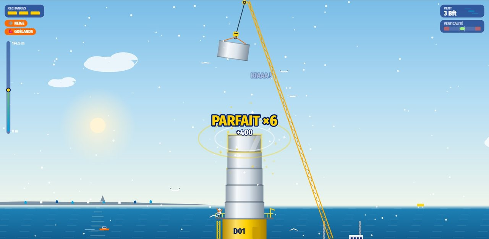
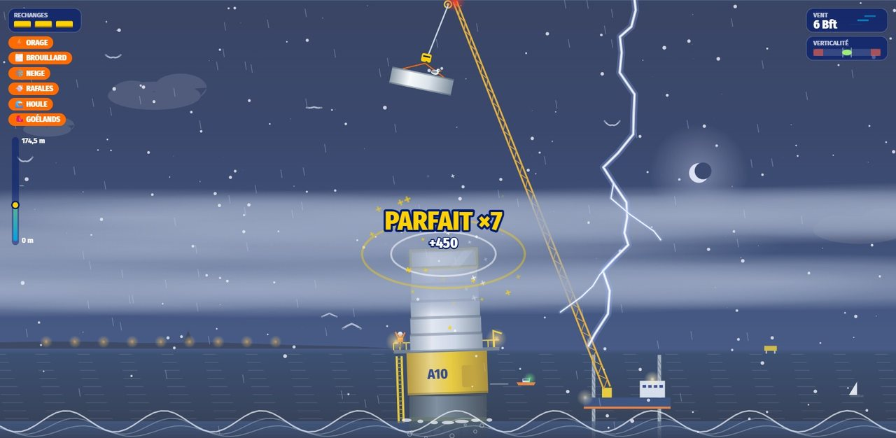

<h1 align="center">🌬️ Pile Poil — offshore construction</h1>

🇫🇷 <a href="README.md">Version française</a>

<b>Raise the 64 turbines of the Calvados offshore wind farm, piece by piece, hanging from a swinging crane.</b> 
The further out you go, the wilder the elements get.

<a href="https://soaresden.github.io/EDF-COUGame/"><b>▶ Play in the browser</b></a> · computer, tablet and phone · French / English

---

## 🎮 The game

You leave the **Ouistreham** base and raise the farm's turbines, from **G01** to **A10**. Each one rises out of the sea and must reach **174.5 m** at the blade tip: transition piece, tower sections, then nacelle and rotor.

- The crane swings the piece on its cable: **tap the screen** or press **Space** to drop it.
- Right on top of the previous one: **PERFECT**. Chained perfects raise the combo and calm the tower's sway.
- Watch the **verticality**: a tower that leans too much tips over.
- **Three pieces overboard** and work on that turbine stops.

Each turbine brought online lights up on the farm map, with a "Did you know?" about the real construction site.

## 🌩️ Every level is different

Each turbine has its own mix of elements, and their number grows across the farm. Before setting sail, the map shows the **difficulty** (a 5-step gauge) and the **elements** waiting for you.

| Turbines | Difficulty | Elements at once |
|---|---|---|
| 1 to 6 | 🟢 Calm | none, or almost |
| 7 to 18 | 🟢 Choppy | 1 |
| 19 to 34 | 🟡 Rough | 2 |
| 35 to 50 | 🟠 Storm | 3 (night always brings its thunderstorm) |
| 51 to 63 | 🔴 Fury | 4 |
| **A10**, the last one | 🔥 **The elements are unleashed!** | all of them, at night |

| Element | What it does |
|---|---|
| 🌙 Night | you see much less, only the site lights shine |
| ⚡ Thunderstorm | pitch-black night, blinding lightning, rain |
| 🌁 Fog | fog banks hide the bottom of the tower |
| ❄️ Snow | snowflakes blown by the wind, slippery pieces: PERFECT gets tighter |
| 💨 Gusts | an announced gust suddenly pushes the piece |
| 🌊 Swell | the sea gets rough and the tower sways more |
| 🐦 Gulls | they land on the piece and make it swing more… KIAAA! |

The number of tower sections, the swing speed and the wind also increase from one turbine to the next.

## 🌊 The real farm

The game's figures are those of the **Calvados offshore wind farm**: 64 turbines of 7 MW (448 MW), 10 to 16 km off Courseulles-sur-Mer, over about 43.5 km². The map layout follows the farm plan, with its cables grouped in strings up to the offshore substation.

## 🛠️ Technical

- A single file, [`index.html`](index.html): HTML, CSS and JavaScript with no library, drawn on a `<canvas>`, sounds generated with Web Audio.
- Progress (turbines online, scores, stars) is kept in the browser (`localStorage`).
- French and English, with the 🇬🇧 EN / 🇫🇷 FR button (the choice is remembered).
- Reduced motion is respected (`prefers-reduced-motion`).

To play offline, just download `index.html` and open it.

---

Game made by <a href="https://github.com/soaresden">soaresden</a>. The logos of the Calvados offshore wind farm and of EDF power solutions belong to their owners.
